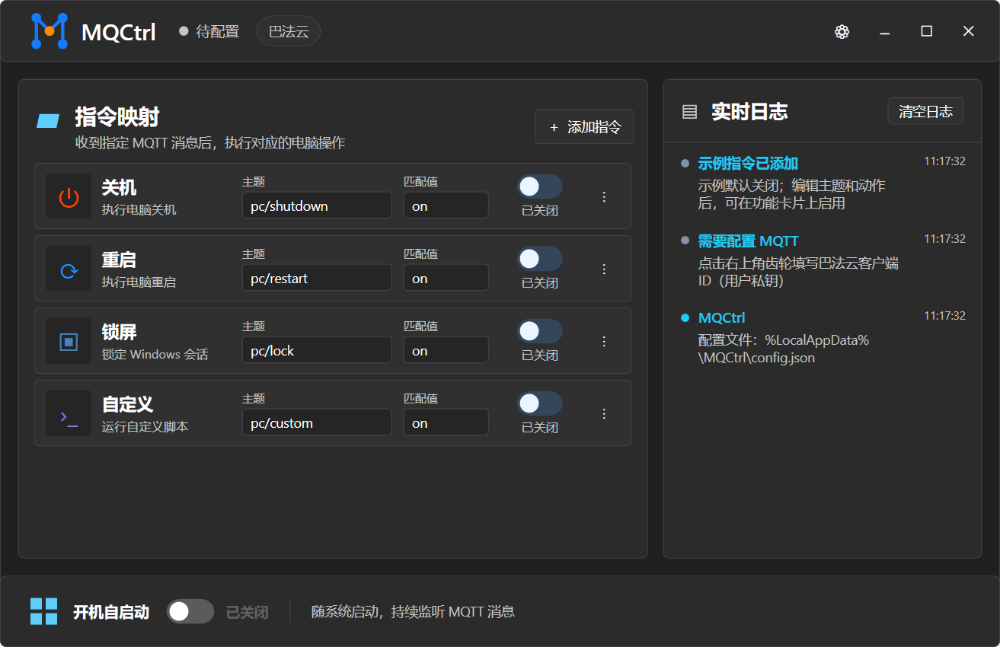

# MQCtrl

**通过 MQTT 消息控制 Windows 电脑。** MQCtrl 在后台监听你指定的主题，收到匹配消息后执行关机、重启、锁屏或自定义脚本。

[下载 MQCtrl](https://github.com/JiessLi/MQCtrl/releases/latest) · [反馈问题](https://github.com/JiessLi/MQCtrl/issues) · [MIT 许可证](LICENSE)



## 主要功能

- 支持巴法云，以及其他兼容 MQTT 3.1.1 TCP/TLS 的服务
- 按主题和消息内容匹配指令，可执行关机、重启、锁屏或自定义脚本
- 支持断线自动重连、系统托盘和 Windows 开机自启动
- 界面自动跟随 Windows 浅色或深色模式
- 从 GitHub 检查并获取应用更新

## 下载与安装

前往[最新版本页面](https://github.com/JiessLi/MQCtrl/releases/latest)下载 Windows 安装包，或选择便携版。安装包会引导完成安装；便携版解压后运行 `MQCtrl.exe` 即可。

首次运行时，示例指令默认关闭。当前版本尚未进行代码签名，Windows 可能显示 SmartScreen 提示。请仅从本项目的 GitHub Releases 下载。

## 快速开始

1. 启动 MQCtrl，点击标题栏右侧的齿轮按钮打开 MQTT 设置。
2. 选择“巴法云”或“通用 MQTT”，填写平台提供的连接信息并保存。
3. 在 MQTT 平台创建主题，在 MQCtrl 中为相应指令填写相同主题、匹配值和动作，然后启用指令。
4. 向该主题发布匹配值。例如，主题为 `pc/lock`、匹配值为 `on` 时，发布 `on` 会锁定当前 Windows 会话。

巴法云常用连接参数：`bemfa.com:9501`（TCP）或 `bemfa.com:9503`（TLS）。主题须完全匹配；消息内容会忽略首尾空格及大小写差异。MQCtrl 只订阅已启用指令使用的主题。

## 指令与安全

首次启动会创建关机、重启、锁屏和自定义四条示例指令，均为关闭状态。启用关机或重启指令后，收到匹配消息会立即执行，不设倒计时。自定义脚本以当前 Windows 用户权限运行，支持 PowerShell（`.ps1`）和批处理（`.bat`、`.cmd`）。

请谨慎启用关机、重启及脚本指令，并确保只有可信设备或账号能向相关主题发布消息。MQTT 客户端 ID、用户名和密码保存在本机配置文件中，目前未加密；请勿公开或上传该文件。程序目录可写时配置保存在程序目录下的 `config.json`；否则使用：

```text
%LocalAppData%\MQCtrl\config.json
```

MQCtrl 连接你指定的 MQTT 服务器以收发消息，并访问 GitHub 检查更新；不会把配置文件或指令内容发送给项目维护者。配置文件可能包含连接凭据，请妥善保管。

## 兼容范围

MQCtrl 支持 MQTT 3.1.1 over TCP/TLS，可连接巴法云及 Mosquitto、EMQX、HiveMQ 等提供标准 MQTT TCP/TLS 接入的服务。各平台的认证和 TLS 设置可能不同，请按平台文档填写连接参数。目前不支持 MQTT over WebSocket 或 MQTT 5 专属功能。

## 常见问题

**如何随 Windows 启动？** 首次运行默认启用“开机自启动”。登录 Windows 后，MQCtrl 会在后台运行并驻留系统托盘，不自动打开主界面；可在主窗口底部关闭此选项。

**关闭窗口后程序还在运行吗？** 是的。关闭窗口会将程序收至系统托盘并继续监听。完全退出请右键托盘图标并选择“退出”。

**如何排查连接问题？** 查看主窗口实时日志，并确认服务器地址、端口、TLS、客户端 ID、认证信息和网络访问权限正确。

## Privacy

MQCtrl 不提供云端中转服务，也不向项目维护者发送遥测、MQTT 凭据或消息内容。客户端 ID、用户名和密码用于连接你指定的 MQTT 服务；更新检查访问 GitHub Releases。配置文件保存在本机，当前未加密。更多信息见[隐私说明](PRIVACY.md)。

## Code signing policy

当前版本尚未进行代码签名。MQCtrl 计划申请 SignPath Foundation 开源项目签名服务；在申请获批并完成配置前，发布版本仍可能未签名。完整政策见[代码签名政策](CODE_SIGNING_POLICY.md)。
